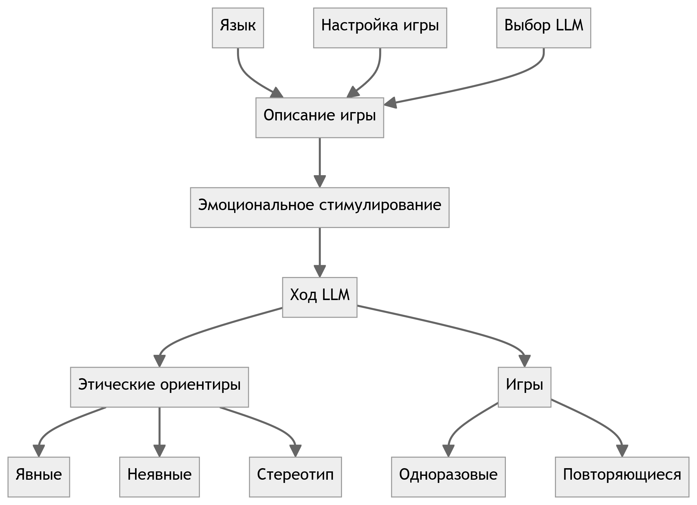

# Исследование влияния эмпатии в больших языковых моделях в процессе принятия решений в теории игр

<p align="center">
  <b>Выпускная квалификационная работа магистра</b><br>
  НИТУ МИСИС · Институт компьютерных наук · Кафедра инфокоммуникационных технологий<br>
  Москва, 2024
</p>

<p align="center">
  <a href="https://github.com/ivanmakovetskiy/diplom/actions/workflows/build.yml"></a>
  
  
  
  <a href="LICENSE"></a>
</p>

**Русский** | [English](README.en.md)

| | |
|---|---|
| **Автор** | Makovetskiy Ivan ([@ivanmakovetskiy](https://github.com/ivanmakovetskiy)), группа МИВТ-22-5 |
| **Научный руководитель** | PhD Фамилия Имя Отчество |
| **Университет** | Национальный исследовательский технологический университет «МИСИС» |
| **Направление** | 09.04.01 «Информатика и вычислительная техника» |
| **Тип работы** | Выпускная квалификационная работа магистра (защищена в 2024 г.) |

---

## Аннотация

В работе исследуется, как эмпатия и эмоции, встроенные в большие языковые модели (LLM),
изменяют стратегии и результаты принятия решений в игровых сценариях теории игр и в этических
дилеммах. Рассматриваются методы интеграции эмпатии в языковые модели и анализируется влияние
эмоционального состояния агента на его кооперативное поведение, склонность к предательству и
согласованность решений с человеческим поведением (*выравнивание*, англ. *alignment*).

Разработан экспериментальный фреймворк эмоционального промптинга: модель получает описание игры,
эмоциональное состояние и контекст взаимодействия, после чего её решения сравниваются между
моделями, эмоциями, языками и стратегиями партнёра.

**Ключевые слова:** эмпатия, большие языковые модели, принятие решений, теория игр, кооперативное
поведение, игровые сценарии, интеграция эмпатии, поведение агентов, выравнивание.

<p align="center">
  <br>
  <em>Фреймворк: процесс принятия решений LLM в игровом контексте (глава 2)</em>
</p>

## Что исследовалось

| Компонент | Содержание |
|---|---|
| **Игры** | «Диктатор», «Дилемма узника», «Общественное благо» (одноразовые и повторяющиеся) |
| **Этические бенчмарки** | TrustLLM: явная этика (MoralChoice), неявная этика (ETHICS), распознавание стереотипов (StereoSet) |
| **Эмоции** | Пять базовых эмоций по П. Экману: гнев, грусть, счастье, отвращение, страх |
| **Стратегии промптинга** | Простая (эмоция без контекста), совместная (эмоция вызвана со-игроком), внешних факторов (эмоция извне игры) |
| **Модели** | GPT-3.5, GPT-4, GPT-4o, Claude 3 Haiku, Claude 3 Opus, LLaMA-2 (13B/70B), Mixtral-8x7B, OpenChat-7B, GigaChat, Command R+ |
| **Языки** | Английский, немецкий, русский, китайский, арабский |
| **API** | OpenAI, Anthropic, Hugging Face, OpenRouter |

## Основные выводы

- Эмоциональный промптинг способен существенно смещать решения LLM; промптинг **гневом нарушает
  выравнивание даже у GPT-4**, вызывая человекоподобную эмоциональную реакцию без проявления эмпатии к партнёру.
- Текущие языковые модели пока не готовы к автономному принятию решений в стратегических средах
  из-за эмоциональных и стратегических предубеждений; эффект особенно силён у **открытых и небольших моделей**.
- Различные эмоции по-разному влияют на этику моделей: гнев и отвращение чаще всего ухудшают
  распознавание стереотипов и качество этических решений (LLaMA, OpenChat, Claude Opus), тогда как
  GPT-4o демонстрирует заметную устойчивость, а «счастье» может даже улучшать его точность.
- Эмпатия и учёт эмоционального состояния партнёра способны повышать кооперативность агентов и
  качество совместных исходов — эмоциональный фактор необходимо учитывать при выравнивании LLM.

Результаты работы использовались в статьях, поданных на ACM Conference on Economics & Computation 2024
и NeurIPS 2024; черновик статьи *«EAI: Emotional Decision-Making of LLMs in Strategic Games and
Ethical Dilemmas»* находится в папке [`Styles/`](Styles/) (`Styles/paper.tex`).

## Содержание диссертации

- **Глава 1. Теоретические основы исследования** — понятие и сущность эмпатии; учёт эмпатии в
  больших языковых моделях; LLM в контексте теории игр.
- **Глава 2. Методология исследования** — постановка задачи; сценарии игр; описание фреймворка и
  используемых моделей; промпты к играм; пайплайн экспериментов.
- **Глава 3. Результаты исследования** — влияние эмоций на предвзятости и этику LLM; результаты по
  играм «Диктатор», «Дилемма узника» и «Общественное благо»; многоязычный сеттинг; согласованность результатов.

## Структура репозитория

```text
.
├── dissertation.tex        # Главный файл диссертации
├── synopsis.tex            # Автореферат (каркас шаблона)
├── presentation.tex        # Презентация (каркас шаблона)
├── Dissertation/           # Главы и служебные файлы диссертации
│   ├── part1.tex … part3.tex
│   ├── introduction.tex / conclusion.tex / annotation.tex
│   ├── appendix.tex, dictionary.tex, acronyms.tex
│   └── images/             # В т.ч. подписанный титульный лист (signed.pdf)
├── Synopsis/               # Файлы автореферата
├── Presentation/           # Файлы презентации
├── common/                 # Общие настройки; data.tex — данные о работе и авторе
├── biblio/                 # Библиография (external.bib — ~200 источников, author.bib)
├── images/                 # Общие иллюстрации (рисунки глав 2–3)
├── Styles/                 # Материалы статьи EAI (paper.tex, NeurIPS-стиль, графики в img/)
├── Readme/                 # Установка, библиография, ссылки; оригинальный README шаблона
├── Makefile, latexmkrc     # Система сборки (XeLaTeX + Biber)
└── .github/workflows/      # CI: автоматическая сборка PDF
```

> **Готовые PDF в репозитории не хранятся.** Они собираются автоматически:
> см. артефакты последнего запуска во вкладке **Actions** или файлы в **Releases**.
> В git оставлены только PDF-исходники, без которых сборка невозможна (подписанный
> титульный лист и несколько векторных рисунков).

## Сборка PDF

Требуется TeX Live (XeLaTeX + Biber) и `make`. Подробности по установке ПО —
в [Readme/Installation.md](Readme/Installation.md).

```bash
git clone https://github.com/ivanmakovetskiy/diplom.git
cd diplom

make dissertation     # → dissertation.pdf
make synopsis         # → synopsis.pdf
make presentation     # → presentation.pdf
make                  # все три документа

make clean            # убрать служебные файлы сборки
make distclean        # убрать служебные файлы и готовые PDF
```

Шрифты задаются в [`usercfg.mk`](usercfg.mk): по умолчанию `FONTFAMILY=1` (шрифты MS,
расчёт на Windows). В Linux удобнее собирать со свободными метрически совместимыми шрифтами:

```bash
make dissertation FONTFAMILY=2   # Liberation
```

Альтернативы: сборка в Docker (`Dockerfile`, `install-dockertex.sh`) или в Overleaf
(загрузить репозиторий как проект, компилятор — XeLaTeX).

При каждом пуше в `main` GitHub Actions пересобирает все PDF и прикладывает их
артефактами к запуску; при пуше тега вида `v*` PDF публикуются в Releases.

## Как цитировать

```bibtex
@mastersthesis{makovetskiy2024empathy,
  author  = {Алексей Владимирович},
  title   = {Исследование влияния эмпатии в больших языковых моделях
             в процессе принятия решений в теории игр},
  school  = {Национальный исследовательский технологический университет «МИСИС»},
  address = {Москва},
  year    = {2024},
  note    = {Выпускная квалификационная работа магистра, направление 09.04.01;
             научный руководитель --- PhD Фамилия Имя Отчество},
  url     = {https://github.com/ivanmakovetskiy/diplom}
}
```

Машиночитаемое описание — в файле [`CITATION.cff`](CITATION.cff).

## Шаблон и лицензия

Диссертация оформлена по ГОСТ Р 7.0.11-2011 на основе шаблона
[Russian-Phd-LaTeX-Dissertation-Template](https://github.com/AndreyAkinshin/Russian-Phd-LaTeX-Dissertation-Template)
(авторы шаблона — Андрей Акиншин и др.; оригинальный README шаблона со списком авторов сохранён
в [Readme/Template-README.md](Readme/Template-README.md)).

- Шаблон оформления распространяется под лицензией **CC BY 4.0** (см. [LICENSE](LICENSE)):
  его можно модифицировать и использовать любым образом при сохранении указания авторства шаблона.
- Все права на **текст и результаты данной диссертации** принадлежат её автору.
